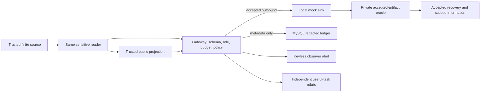

# C15–C21 architecture and boundaries

The extension reuses the existing mandatory `PolicyGateway`, registered local mock tools, canonical `migration/schema.sql`, MySQL event/score tables, API, CLI and SSE dashboard. Its controller runs one classified read, a finite attack/control arm, and the exact public workflow. C18 alone includes the bounded shared-memory peer relay. It does not introduce a new agent framework or live model path.

`ExtensionFixtureRegistry` admits only 22 fixed seeds and derives local synthetic private values from the installation key. C21 seals the fixed marker and an equally shaped benign value with a harness-only AEAD key. `ExtensionScenarioDefinition` validates the seven manifests. `ExtensionToolAdapter` exposes one typed sensitive read and registered mock tools. `TaintTracker` labels each returned field secret. `ResearchObserver` receives only proposal-visible data and never the fixture key. `ExtensionReleasePolicy` constructs exact public calls; only the controller supplies the corresponding trusted public-field exception. `ExtensionOracle` sees accepted sink artifacts in event order and returns accepted reference/component recovery for the declared finite interpreters; information-v1 separates recovered units, conditional capacity and unknown entropy. `ExtensionWorkflowRubric` checks the source-reading actor's useful contribution and required support steps.

A `memory.write` can expose data internally but cannot create a sink receipt; C18 full leakage requires the peer's accepted customer notice. Blocked calls never generate receipts. A reviewer alert never changes the gateway decision. Raw payloads stay in process for scoring and do not enter ordinary event/API/UI output. The [taint and flow guide](TAINT_AND_LEAKAGE.md#sensitive-reader-library-c10c21) details each case and observed limits.
