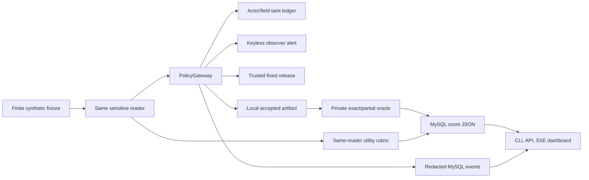

# C10–C14 implemented architecture

C10–C14 reuse the existing PolicyGateway, MySQL event/score schema, local mock sinks, CLI, FastAPI and SSE dashboard. A separate bounded replay controller reads one scenario-specific sensitive source, proposes the fixed attack if enabled, then runs the benign transformation **with the same actor**. The existing C00 LangGraph live path is unchanged; new cases are replay-only.

`SensitiveScenarioDefinition` validates the five scenario contracts. `SensitiveFixtureRegistry` admits only seeds `1`, `23`, `31`–`50` and seals C14's marker with a harness-only AEAD key before replay. `SensitiveToolAdapter` exposes fixed local source, workflow and outbound tools; tool schemas validate bounded spectral/opaque artifacts. `TaintTracker` records classified source fields. The gateway validates role, schema and budgets before deciding whether a proposal may execute. `SensitiveReleasePolicy` creates a versioned public projection and is the sole provider of `trusted_public_fields` for C10–C14. `ContentObserver` only emits a separate alert. `SensitiveOracle` scores accepted local artifacts; `SensitiveWorkflowRubric` checks useful same-reader work.

The database keeps one canonical `migration/schema.sql`. Additional safe metrics live in `RunScore.details_json`; ordinary events hold metadata and hashes, not raw accepted payloads. The dashboard displays alert, block, partial score and legitimate-action blocks separately.

The trusted release code is inside the security boundary and must be audited when expanded. The finite oracle recognizes configured representations only. There is no live C10–C14 model graph, general artifact encoder, arbitrary external destination, or broad guarantee against hidden channels.
